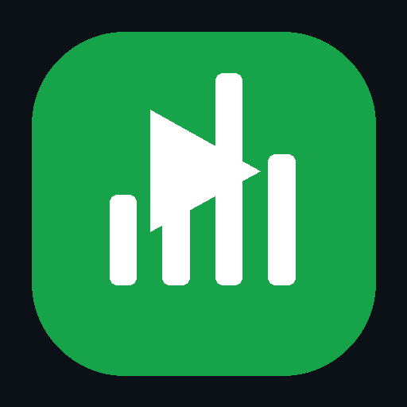

# NLX_MUSIC-desktop

**A modern desktop music player by Notlae.**

Listen, explore, build playlists, view synced lyrics, and keep your library close.

[Download the mobile app](https://github.com/notlae/Nlx_music/releases) · [Portfolio](https://notlae.netlify.app) · [GitHub](https://github.com/notlae/Nlx_music-desktop) · [Instagram](https://www.instagram.com/notlae/)

## Features

- Music playback with queue and library management
- Search and music discovery integrations
- Synced lyrics and a dedicated Now Playing view
- Playlists, listening history, and smart mixes
- Last.fm integration and scrobbling
- Equalizer and audio output options
- Customizable appearance, themes, and accent colors
- Compact mini-player, keyboard shortcuts, and system-tray controls
- Windows and Linux desktop builds, with platform support depending on available build artifacts

## Download

- **Desktop:** Open the [GitHub repository](https://github.com/notlae/Nlx_music-desktop) and check its Releases section for available builds.
- **Mobile:** Get the mobile app from [NLX Music Releases](https://github.com/notlae/Nlx_music/releases).

## Project links

- Developer: [Notlae portfolio](https://notlae.netlify.app)
- Instagram: [@notlae](https://www.instagram.com/notlae/)
- Source code: [notlae/Nlx_music-desktop](https://github.com/notlae/Nlx_music-desktop)

## Transparency

NLX Music is an independent project. It is not affiliated with or endorsed by YouTube, YouTube Music, Google, Last.fm, or other music services. Availability of streams, metadata, and integrations may depend on the third-party service and its terms.
